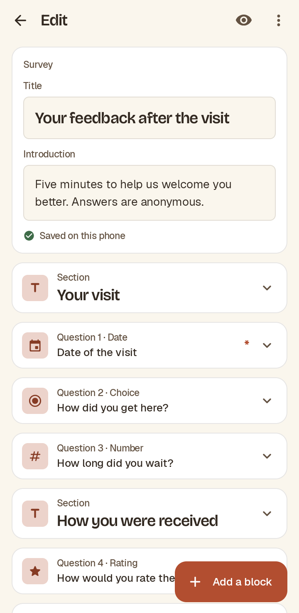
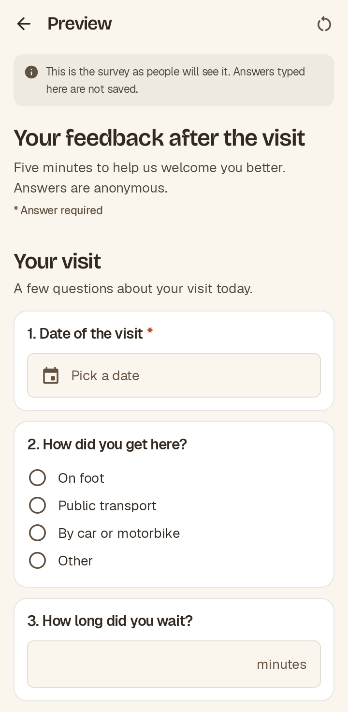

# Survix

**Write surveys on an Android phone, keep them there, export them when you need them.**

Survix is a survey editor for Android from [Helix](https://org-helix.github.io/helix-website/), which builds public-good software for the communities that mainstream tech leaves behind: schools, clinics and the people they serve. A teacher preparing a feedback form, a clinic drafting an intake questionnaire or a community group planning a consultation can build it block by block, on a modest phone, with no connection and no account.

Like every Helix app, Survix is free, open source and offline first. It has no Internet permission, no ads and no tracking: surveys stay on the phone until you export or share them.

[**Download the latest APK**](https://github.com/org-helix/survix/releases/latest/download/survix-android.apk) · Android 7.0 or newer · Français / English · [All releases](https://github.com/org-helix/survix/releases)

<p align="center">
  
  
</p>

## Features

- **Library**: every survey on the phone, newest first, with search once there are a few. Open, preview, duplicate, export, share or delete (with undo) from each card.
- **Blocks**: a survey is a list of modules, added from a sheet and edited in place. Open a block to edit it; move it up or down, duplicate or delete it.

  | Block | What it asks |
  |---|---|
  | Section | Nothing: a title and a text that split the survey into parts. |
  | Free text | A short answer or a paragraph, with an optional hint. |
  | Choice | One or several options, with an optional "Other" field. |
  | Yes / No | A closed question. |
  | Rating | A score on a scale of 2 to 10 points, with labels for both ends. |
  | Number | A value, with optional minimum, maximum and unit. |
  | Date | A day on the calendar. |

  Every question has a label, a help text and a "required" switch. The editor flags empty labels, missing or duplicated options and reversed bounds.
- **Saved as you type**: edits are kept in memory at once and written to the phone a moment later, and again when the app goes to the background. Files are written atomically, so a crash never leaves a half-written survey.
- **Preview**: fill in the survey as a respondent would and check required answers and number bounds. Nothing typed there is saved.
- **Export and import**:
  - `.survix.json`: readable, versioned JSON ([format](docs/format.md)), one survey or all of them in one file. Import it on any phone with **Import a file**, by opening it from a file manager, or by sharing it to Survix. Importing never overwrites an existing survey.
  - `.md`: the survey as Markdown, ready to print or paste into a document.
  - **Share** sends the `.survix.json` file through any app (messaging, email, Bluetooth…).
- **First launch**: choose the language and the look, applied live, and optionally start with an example survey.
- **Languages**: French (default) and English. On Android 13 and newer the language can also be set in the system settings.
- **Themes**: system, light or dark, in the Helix colours.

## Privacy

- No `INTERNET` permission: the app cannot send anything anywhere.
- No account, no ads, no analytics, no tracking.
- Surveys are stored only in the app's private storage. They leave the phone only when you export or share them, and are included in the phone's own backup and device-to-device transfer.

## Install

1. On the phone, download [`survix-android.apk`](https://github.com/org-helix/survix/releases/latest/download/survix-android.apk) from the latest release.
2. Open it and allow your browser or file manager to install unknown apps when Android asks.

Release APKs are currently signed with a temporary key. When releases move to a permanent key, the app will have to be uninstalled once before installing the new version: export your surveys first (**⋮ → Export all** in the library).

Every run of the **CI** workflow also attaches a debug build, `survix-debug.apk`, to the run's artifacts. It installs next to the release app (its id ends in `.debug`).

## Development

Requires JDK 17 and the Android SDK (API 35).

```sh
./gradlew :core:test              # model, file format, store, Markdown, palette contrast, illustration
./gradlew :app:lintDebug
./gradlew :app:assembleDebug      # app/build/outputs/apk/debug/app-debug.apk
./gradlew installDebug            # on a connected phone or emulator
```

| Module | What it holds |
|---|---|
| `core` | Pure Kotlin, no Android: the survey model and editing operations (`Model.kt`, `Edits.kt`), the file format (`SurvixFormat.kt`), the on-disk store (`SurveyStore.kt`), the Markdown export, the Helix palette (`HelixPalette.kt`) and the pixel sunset. All unit-tested on the JVM. |
| `app` | The Android app in Jetpack Compose: `data/` (repository, settings, file picker and sharing), `ui/theme/` (Helix theme and type scale), `ui/components/` (buttons, cards, fields, the Helix mark), and one package per screen: `welcome`, `library`, `editor`, `preview`, `settings`. |

- Strings live in `app/src/main/res/values/strings.xml` (French) and `values-en/strings.xml` (English); add every string to both.
- Colours live only in `HelixPalette.kt` (see [Design](#design)).
- The store listing (title, short and full description, changelogs) is in [`fastlane/metadata/android`](fastlane/metadata/android), in French and English.

## Releasing

1. Raise `versionCode` and `versionName` in `app/build.gradle.kts`.
2. Write the release notes in `docs/releases/vX.Y.Z.md` and the store changelog in `fastlane/metadata/android/*/changelogs/<versionCode>.txt`.
3. Push a `vX.Y.Z` tag, or run the **Release** workflow by hand with `vX.Y.Z` as the version: it tests, builds `survix-android.apk`, creates the tag on the commit it built and publishes the release with those notes.

To fix the notes of a published release, edit its file in `docs/releases/` and run the **Release notes** workflow with its tag.

To sign with a permanent key, set the repository secrets `SURVIX_KEYSTORE_BASE64`, `SURVIX_KEYSTORE_PASSWORD`, `SURVIX_KEY_ALIAS` and `SURVIX_KEY_PASSWORD` (see the top of `.github/workflows/release.yml`). Without them the APK is signed with a temporary key.

## Design

Survix follows the Helix design used by [netlix](https://github.com/org-helix/netlix) and the [Helix website](https://github.com/org-helix/helix-website): the Helix colour palette on the Dusk DS structure, Bricolage Grotesque titles with negative tracking, Geist text, a 4 dp grid, radii of 8, 12 and 16, and no drop shadows (cards have a hairline outline instead). Red `#B24E30` is the only action colour. The light theme puts ink `#322921` on Pale Amber `#FAF6ED` with Paper cards; the dark theme is the dark Helix sky (`#1E1914` canvas, Pale Amber text, Blush focus ring).

All colours live in `core/src/main/kotlin/org/helix/survix/core/HelixPalette.kt`, and `HelixPaletteTest` checks that every text and background pair meets WCAG AA in both themes.

## Credits

- **[Helix](https://github.com/org-helix)** designs, builds and maintains Survix. The app credits Helix on its welcome screen and in **Settings → About**.
- **Fonts**: [Bricolage Grotesque](https://github.com/ateliertriay/bricolage) and [Geist](https://github.com/vercel/geist-font), bundled under the SIL Open Font License ([`docs/licenses`](docs/licenses)).
- **Icons**: [Material Icons](https://github.com/google/material-design-icons) (Apache License 2.0), through the Jetpack Compose icon library.

Questions, ideas and bug reports are welcome in the [issues](https://github.com/org-helix/survix/issues). Before sending a change, read the [Helix contributing guide](https://github.com/org-helix/.github/blob/main/CONTRIBUTING.md); to report a security problem, follow the [security policy](https://github.com/org-helix/.github/blob/main/SECURITY.md).

## License

Survix is free software, released under the [GNU General Public License, version 3](LICENSE). You may use, study, share and change it; versions you distribute must stay under the same license. The bundled fonts keep their own license (SIL Open Font License).

> No tracking, no ads, no lock-in. Built for and with the communities that use it.
